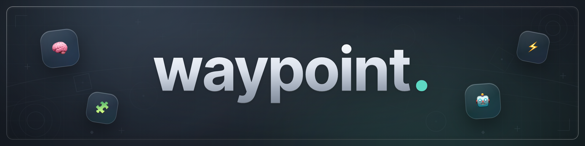

<div align="center">

A simple **workflow** for **agentic engineering**.

</div>

---

## 🚀 Getting Started

Install with Vercel’s [Skills CLI](https://github.com/vercel-labs/skills):

```bash
npx skills add m-borgmann/waypoint --skill '*'
```

Or copy the skills from this repository into your agent’s `skills` directory.

## ✨ Why waypoint?

*waypoint* was made for the **agentic engineer** who wants to stay involved throughout the development cycle. It borrows the discipline of established software engineering practices while embracing the speed and leverage that modern language models provide. Rather than telling the model *how to think*, it tells it *what to produce*.

## 🌟 The workflow

1. **Spec**
   - Use the spec prompt provided below in a **new** chat
   - The agent clarifies requirements and writes `docs/specs/{slug}.md`
   - You answer questions, review the spec, and approve it
2. **Plan**
   - Use the plan prompt provided below in the **same** chat as the spec
   - You review and approve the plan
3. **Build**
   - Tell the agent to start working in the **same** chat as the plan
   - The agent implements the requested changes
4. **Automated Testing** (Optional)
   - Use the test prompt provided below in a **new** chat
   - The agent tests and verifies the implementation
5. **Automated Review** (Optional)
   - Use the review prompt provided below in a **new** chat
   - One agent reviews the code, another agent validates its findings
   - You decide which findings to fix
6. **Manual Test**
   - You manually test the changes
7. **Manual Review**
   - You visualize the diff between the changes and the base branch
   - You review and approve them or adjust the code accordingly
8. **Versioning**
   - Use the versioning prompt provided below
   - The agent commits, pushes and opens a pull request

> [!TIP]
> You may tune the skills and prompts to match your team’s conventions and preferences.

### 💬 Prompts

Spec:

```text
Create a new branch with a fitting name to start working on {slug}, based on the current develop branch. Use the /waypoint skill, the .scratch folder and available tools to gather all the relevant context you need.
```

Plan:

```text
Switch to plan mode and create an implementation plan for @docs/specs/{slug}.md
```

Test:

```text
Test the changes in this branch, if possible E2E, against docs/specs/{slug}.md. Verify the expected flow works and look for edge and error cases. Report your findings when you are done.
```

Review:

```text
Critically review the changes in this branch. What can be refactored, cleaned up or simplified? Have another agent validate your findings.
```

Versioning:

```text
Commit the changes of this branch, push it and open a pull request.
```

CodeRabbit (Optional):

```text
CodeRabbit marked some potential issues on the pull request of this branch. Verify each finding against the current code and draft responses for each in chat.
```

## 🛠️ Tooling

### Essentials

| Tool | Purpose |
| ---- | ------- |
| [Claude Code](https://claude.com/de/product/claude-code) | Agentic Coding Harness |
| [AGENTS.md](https://agents.md/) | Operational rules and instructions for agents |
| [GitHub MCP](https://github.com/github/github-mcp-server) | Versioning, Pull requests, CI |
| [Atlassian MCP](https://claude.com/de/marketplace/connectors/atlassian) | Issue and ticket retrieval |

### Recommended

| Tool | Purpose |
| ---- | ------- |
| `CONTEXT.md` file | Domain and product context for agents |
| `.scratch` folder | Additional files and context for agents, ignored by git |
| [CodeRabbit](https://www.coderabbit.ai/) | External code review |

## 📚 Spec

Output of the waypoint skill and stored in the project workspace:

```text
docs/specs/{slug}.md
```

The `{slug}` is derived from an issue key (e.g. `ABC-123`) and ticket information may be retrieved from an external source, such as Jira or GitHub, using the appropriate MCP.

## 💫 Acknowledgments

*waypoint* draws inspiration from practitioners and research across agentic software engineering:

- Addy Osmani, Shubham Saboo, and Sokratis Kartakis: [The New SDLC With Vibe Coding](https://www.kaggle.com/whitepaper-the-new-SDLC-with-vibe-coding)
- Thariq Shihipar, Anthropic Technical Staff: [The new rules of context engineering](https://claude.com/blog/the-new-rules-of-context-engineering-for-claude-5-generation-models)
- Harjot Gill, CEO of CodeRabbit: [Code is no longer the bottleneck. Understanding is.](https://www.coderabbit.ai/blog/code-is-no-longer-the-bottleneck-understanding-is)
- Matt Pocock: [Skills For Real Engineers](https://github.com/mattpocock/skills)

---

<div align="center">

Made with ❤️ by [Magnus Borgmann](https://github.com/m-borgmann)

</div>
